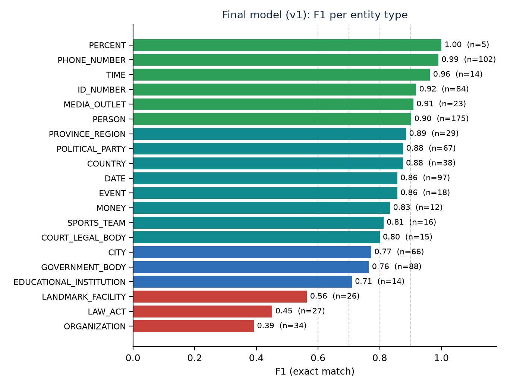

<div align="center">

# Pakistani-Context Named Entity Recognition

**Fine-tuned XLM-RoBERTa that finds 20 entity types in Pakistani text, built on self-collected, self-annotated data.**

TechFest NER Challenge | NEDUET "Dory's Data Dive" | Round 2


</div>

---

## At a glance

| | |
|---|---|
| **Task** | Token classification: tag every word with one of 41 BIO tags (20 entity types x B-/I- plus O) |
| **Final model** | `xlm-roberta-base` (270M parameters) fine-tuned for 4 epochs on a Colab T4 |
| **Data** | 15,390 clean real sentences (Wikipedia, Wikinews, Pakistani news, Supreme Court judgments) + 5,390 synthetic sentences |
| **Labels** | automatic drafts (regex + gazetteers + spaCy), bulk-fixed rules, **500 human-verified sentences** for testing |
| **Score** | **P 0.806 / R 0.822 / F1 0.814** on 764 human-verified entities (exact entity match) |
| **Extra** | zero-shot Urdu check: 21 of 27 expected entities found (tiny sample) |

**Full report:** [`NER_Final_Report.pdf`](NER_Final_Report.pdf)  |  **Every step explained in depth:** [`PROJECT_EXPLAINED.md`](PROJECT_EXPLAINED.md)  |  **Dated decision log:** [`PROJECT_LOG.md`](PROJECT_LOG.md)

## The 20 entity types

| People and places | Organisations | Law and events | Numbers |
|---|---|---|---|
| `PERSON` | `GOVERNMENT_BODY` | `LAW_ACT` | `DATE` |
| `CITY` | `POLITICAL_PARTY` | `COURT_LEGAL_BODY` | `TIME` |
| `PROVINCE_REGION` | `ORGANIZATION` | `EVENT` | `MONEY` (incl. PKR) |
| `COUNTRY` | `EDUCATIONAL_INSTITUTION` | `MEDIA_OUTLET` | `PERCENT` |
| `LANDMARK_FACILITY` | | `SPORTS_TEAM` | `PHONE_NUMBER` (synthetic) |
| | | | `ID_NUMBER` (CNIC, synthetic) |

Example (real output of the final model):

```
Prime Minister Shehbaz Sharif met Imran Khan of PTI in Lahore on 5 March 2024; call 0300-1234567, CNIC 35202-1234567-1.
    PERSON           Shehbaz Sharif
    PERSON           Imran Khan
    POLITICAL_PARTY  PTI
    CITY             Lahore
    DATE             5 March 2024
    PHONE_NUMBER     0300-1234567
    ID_NUMBER        35202-1234567-1
```

## Results



| Evaluation set | Sentences | Entities | Precision | Recall | F1 |
|---|---|---|---|---|---|
| Random test (gold, human-verified) | 200 | 426 | 0.805 | 0.826 | **0.816** |
| Extra test (gold, weak-label enriched) | 100 | 338 | 0.807 | 0.817 | **0.812** |
| **Pooled gold** | 300 | 764 | **0.806** | **0.822** | **0.814** |
| Pattern test (synthetic): PHONE_NUMBER | 188 | 102 | 0.981 | 1.000 | 0.990 |
| Pattern test (synthetic): ID_NUMBER | 188 | 84 | 0.848 | 1.000 | 0.918 |

14 of the 20 types reach F1 of at least 0.80. The weak types are `ORGANIZATION` (0.39), `LAW_ACT` (0.45) and `LANDMARK_FACILITY` (0.56).

### Three runs, one honest conclusion

| Run | Micro F1 | Macro F1 (20 labels) | What changed |
|---|---|---|---|
| **v1 (final)** | 0.814 | 0.807 | first dataset, 4 epochs |
| v2 | 0.814 | 0.798 | + synthetic data, case-number rule, 6 epochs |
| v3 | 0.810 | 0.800 | + masking of unlabelled names |

Two improvement rounds changed the *kind* of error but not the overall score beyond run-to-run noise (about 0.02 F1). The final model was chosen by a rule fixed in advance (pooled micro F1, then macro F1 over all 20 labels, then smallest precision-recall gap), not by the best single number.

## How it was built

```
setup -> collect -> clean -> synthetic -> pre-annotate -> human verify -> rules -> build dataset -> fine-tune -> evaluate
```

1. **Collect:** Wikipedia and Wikinews through official APIs (polite delays, identifying User-Agent) and public Kaggle datasets of Pakistani news and Supreme Court judgments. Private or personal-social-media sets were removed.
2. **Clean and balance:** tolerant decoding, junk removal, abbreviation-safe sentence splitting, de-duplication, per-source and per-document caps.
3. **Synthetic data:** template sentences with exact labels, including fake phone numbers and CNICs.
4. **Pre-annotate:** three layers (regex, gazetteers, spaCy) produce silver labels; each span remembers its layer.
5. **Human verify:** 400 + 100 sentences corrected in Label Studio become gold test data.
6. **Rules:** annotation conventions and a bulk fix learned from review-split errors, with a `trusted` flag.
7. **Build dataset:** split **by document**, remove test siblings and near-duplicates, mask unreliable spans, hard leakage assertions.
8. **Fine-tune:** XLM-RoBERTa-base, first-subtoken labelling, AdamW, lr 3e-5, batch 16, best epoch by validation F1.
9. **Evaluate:** exact-match entity precision, recall and F1, overall and per label; error analysis by kind.

## Ethics and data policy

- Only public sources; site terms checked and logged in [`DATA_SOURCES.md`](DATA_SOURCES.md); rate-limited access; no redistribution of scraped text.
- **No real personal data.** Phone numbers and CNICs are randomly generated.
- Wikipedia text is CC BY-SA 4.0 (credited). An AI assistant helped draft first-pass corrections and code; every test label was verified by a human, and this is disclosed.

## Quick start

```bash
pip install torch transformers accelerate
```

Put the trained model folder at `outputs/xlmr_base/best` (about 1.1 GB; not stored in git, see "Model weights" below), then:

```bash
# one sentence
python scripts/predict.py --model outputs/xlmr_base/best --text "The Supreme Court of Pakistan reserved its verdict on Tuesday."

# a file with one text per line, saved as JSON lines (entities with label, text, character offsets, tokens, tags)
python scripts/predict.py --model outputs/xlmr_base/best --input my_texts.txt --out predictions.jsonl

# re-score a saved model on all test sets (no training)
python scripts/train_ner.py --eval_only outputs/xlmr_base/best --out outputs/eval_v1
```

### Notebooks (Google Colab, T4 GPU)

| Notebook | Purpose |
|---|---|
| [`01_preannotation_colab.ipynb`](notebooks/01_preannotation_colab.ipynb) | draft labels with spaCy |
| [`02_train_colab.ipynb`](notebooks/02_train_colab.ipynb) | fine-tune and evaluate |
| [`03_eval_predict_all_models.ipynb`](notebooks/03_eval_predict_all_models.ipynb) | re-score and compare all runs, predict a long paragraph |
| [`04_urdu_check_v1.ipynb`](notebooks/04_urdu_check_v1.ipynb) | zero-shot Urdu sanity check |

### Rebuild the data and the report

```bash
python scripts/build_dataset.py        # builds data/dataset/*.jsonl and runs the leakage assertions
python scripts/compare_runs.py trained_reports/evals/outputs/eval_v1 trained_reports/evals/outputs/eval_v2 trained_reports/evals/outputs/eval_v3
python scripts/make_report_pdf.py      # needs: pip install reportlab matplotlib
```

## Repository map

| Path | Content |
|---|---|
| `scripts/` | collection, cleaning, synthetic data, pre-annotation, rules, dataset builder, training, evaluation, prediction, report generator |
| `data/` | raw sentences, gazetteers, annotated files, final `dataset/` splits and the leakage report |
| `notebooks/` | Colab notebooks (table above) |
| `trained_reports/` | metrics, reports and error lists for v1, v2, v3, the evaluation re-scores and the Urdu check |
| `GUIDELINES.md` | annotation rules for all 20 types |
| `DATA_SOURCES.md` | every source with its terms |
| `PROJECT_LOG.md` | dated decisions with numbers |
| `PROJECT_EXPLAINED.md` | every step: what, why and how, from tokenization to evaluation |
| `ERROR_ANALYSIS.md` | the error-analysis method |
| `NER_Final_Report.pdf` | the final report |

## Data and model weights are not included

Following our data policy (we do not redistribute scraped or downloaded text), the repository does not contain the Kaggle datasets, Wikipedia extracts, annotated sentences or the built `data/dataset/` files; `.gitignore` excludes them. Re-create them with the scripts in the order given in the report (section 15): download the public datasets listed in [`DATA_SOURCES.md`](DATA_SOURCES.md) into `datasets/`, then run `build_corpus.py`, `preannotate.py`, the Label Studio import scripts and `build_dataset.py`. Gazetteers, synthetic data, scripts, notebooks, guidelines, metrics and the report are included.

The fine-tuned weights (`best/`, about 1.1 GB) are also excluded; keep them in cloud storage or Git LFS and place them at `outputs/xlmr_base/best`.

## Known limitations

- Most training labels are machine-made; only about 500 sentences are human-verified.
- Test sets are small: rare-type scores rest on 2 to 18 entities and are noisy.
- Test sets are not fully unseen: error categories were studied on them (no test text was added to training and no test label was edited).
- Phone and CNIC scores come from synthetic data only.
- English-first; Urdu is a zero-shot sanity check, not a trained feature.
